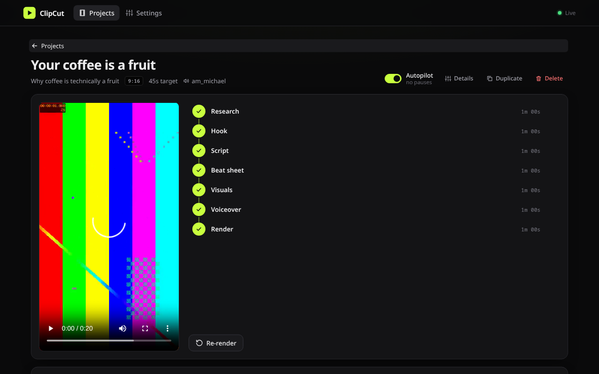

<p align="center">
  
</p>

<h1 align="center">ClipCut</h1>

<p align="center">
  Type a topic. Get a fast-cut short video made from real footage.
</p>

<p align="center">
  <a href="https://github.com/adeebahmad01/clipcut/releases/latest"></a>
  <a href="https://github.com/adeebahmad01/clipcut/actions/workflows/ci.yml"></a>
  <a href="LICENSE"></a>
</p>

<p align="center">
  <a href="https://adeebahmad01.github.io/clipcut/"><b>Website</b></a> ·
  <a href="https://github.com/adeebahmad01/clipcut/releases/latest"><b>Download</b></a> ·
  <a href="docs/Installation.md"><b>Install guide</b></a> ·
  <a href="docs/Usage.md"><b>Usage</b></a>
</p>



ClipCut writes a script about your topic, then cuts a 9:16 or 16:9 video
out of 1–3 second YouTube moments, highlighted article screenshots,
captioned memes and reaction GIFs. Stock footage is the last resort. Every
cut animates in with a sound effect. Word-by-word captions, icons and short
on-screen text sit on top, with a local AI voiceover underneath.

It runs on your own machine as one native binary with a built-in web UI.
The voice, search and downloads are free and local; the only account you
need is Claude Code, which writes the script.

```
Research → Hook → Script → Beat sheet → Visuals → Voiceover → Render
```

You can review and edit each stage before the next one runs, or turn on
**Autopilot** and get a finished `final.mp4` with a `credits.txt` listing
every source.

## Install

**Linux and macOS**, one line. It installs the binary, then offers to
install each tool ClipCut uses:

```bash
curl -fsSL https://github.com/adeebahmad01/clipcut/releases/latest/download/install.sh | sh
```

Or download an archive from the
[latest release](https://github.com/adeebahmad01/clipcut/releases/latest):

| Platform | Download |
|---|---|
| Linux x86_64 | [clipcut-x86_64-unknown-linux-gnu.tar.gz](https://github.com/adeebahmad01/clipcut/releases/latest/download/clipcut-x86_64-unknown-linux-gnu.tar.gz) |
| Linux ARM64 | [clipcut-aarch64-unknown-linux-gnu.tar.gz](https://github.com/adeebahmad01/clipcut/releases/latest/download/clipcut-aarch64-unknown-linux-gnu.tar.gz) |
| macOS Apple silicon | [clipcut-aarch64-apple-darwin.tar.gz](https://github.com/adeebahmad01/clipcut/releases/latest/download/clipcut-aarch64-apple-darwin.tar.gz) |
| Windows | Use [WSL2](https://learn.microsoft.com/windows/wsl/install) and the Linux installer |

### What it needs

| Tool | Why | Required |
|---|---|---|
| [ffmpeg](https://ffmpeg.org/download.html) | Cutting clips and encoding the video | Yes |
| [espeak-ng](https://github.com/espeak-ng/espeak-ng/releases) | Pronunciation for the Kokoro voice | Yes |
| [Claude Code](https://docs.claude.com/en/docs/claude-code/setup) | Writes the research, hooks, script and beat sheet. Run `claude` once to sign in | Yes |
| [Chromium or Chrome](https://www.google.com/chrome/) | Article screenshots and the app window | Recommended |
| [Node.js](https://nodejs.org/en/download) | Lets yt-dlp pass YouTube's player checks | Recommended |
| [Python 3](https://www.python.org/downloads/) + [unslop skill](https://github.com/theclaymethod/unslop) | Rewrites the script so it sounds less like AI | Optional |
| [Podman](https://podman.io/docs/installation) or Docker | Runs a private SearXNG search. Without it, DuckDuckGo is used | Optional |

ClipCut downloads the rest by itself on first start: the
[yt-dlp](https://github.com/yt-dlp/yt-dlp) binary, the
[Kokoro-82M](https://huggingface.co/hexgrad/Kokoro-82M) voice model (about
205 MB) and the SearXNG container.

Full instructions per OS are in [docs/Installation.md](docs/Installation.md).

## Run it

```bash
clipcut
```

```
  ClipCut 0.1.0 is running

  Local:   http://localhost:7878
  Network: http://192.168.1.20:7878
  Data:    ~/.local/share/clipcut
```

Open either URL. The Network URL works from your phone on the same Wi-Fi.
If Chromium is installed, an app window opens too (`--no-window` skips it).

Check that every piece is in place:

```bash
clipcut doctor
```

Or make a video without the UI:

```bash
clipcut new "Why the Moon is drifting away" --seconds 40
```

More in [docs/Usage.md](docs/Usage.md).

## Free API keys (optional)

GIFs and stock footage get better with free keys. Add them in
**Settings → Keys**. Each service takes up to five keys; ClipCut rotates
through them, rests a key that hits a rate limit, and drops one that comes
back invalid.

| Service | Used for | Get a key |
|---|---|---|
| GIPHY | Reaction GIFs | [developers.giphy.com](https://developers.giphy.com/) |
| Tenor | GIF fallback | [Tenor API in Google Cloud](https://developers.google.com/tenor/guides/quickstart) |
| Pexels | Stock video and photos | [pexels.com/api](https://www.pexels.com/api/) |
| Pixabay | Stock fallback | [pixabay.com/api/docs](https://pixabay.com/api/docs/) |

Imgflip memes, Wikimedia and Openverse images, Iconify icons, SearXNG,
DuckDuckGo and YouTube need no keys.

## Docs

- [Installation](docs/Installation.md): every OS, every dependency, building from source
- [Usage](docs/Usage.md): the web app, the CLI, projects, music and sound effects
- [Configuration](docs/Configuration.md): every `config.toml` setting
- [Troubleshooting](docs/Troubleshooting.md): fixes for common problems
- [Architecture](docs/Architecture.md): how the crates fit together
- [HTTP API](docs/API.md): the API the web UI uses

## Use footage responsibly

ClipCut pulls short clips from YouTube and other public sources and writes
every one into `credits.txt`. You are responsible for how you use what it
makes. Check the terms of the sites you take footage from and the rules of
the platform you post to. Use `youtube.channel_blocklist` to skip channels
you do not want to clip.

## Contributing

Bug reports and pull requests are welcome. See
[CONTRIBUTING.md](CONTRIBUTING.md).

## License

[MIT](LICENSE). The bundled fonts (Anton, Archivo Black, Inter) are under the
[SIL Open Font License](assets/fonts/OFL.txt).
